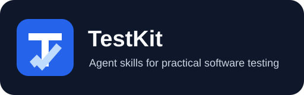

<p align="center">
  
</p>

<p align="center">
  面向测试工程师和开发者的 Agent Skills：把需求变成测试用例，把执行过程变成可追溯的测试结果。
</p>

<p align="center">
  <a href="README.md">English</a> | 简体中文
</p>

<p align="center">
  <a href="https://github.com/winhok/testkit/stargazers">
    
  </a>
  <a href="https://github.com/winhok/testkit/forks">
    
  </a>
  <a href="https://github.com/winhok/testkit/blob/main/LICENSE">
    
  </a>
</p>

# TestKit

TestKit 将可复用、可审查的测试流程封装为 [Agent Skills](https://agentskills.io/)，供 Claude Code、Codex 和其他兼容工具使用。它以当前需求和可追溯的执行证据为基础，连接测试设计、自动化、问题诊断、缺陷复测和验收。

## 101 秒了解 TestKit

用一个权限控制示例，串起需求澄清、用例评审、执行留证和验收判断。以下为概念演示，非真实测试记录。

https://github.com/user-attachments/assets/024498b5-8d9b-400f-aa01-dc73053c86b0

[打开 MP4 文件](assets/readme/testkit-demo.zh-CN.mp4) · 中文旁白与字幕。

## 为什么使用 TestKit

- **贯通测试流程：** 从 PRD 整理、测试分析、策略、测试点和用例评审，延伸到执行、缺陷复测与验收。
- **互补的 API 测试路径：** 用 Arazzo 表达确定性的业务流程，用 Schemathesis 执行示例、覆盖、模糊和有状态测试。
- **Android、iOS、Web 共用证据契约：** 执行前冻结版本、环境和范围，执行后关联原始证据，避免重试或旧结果被错误计为通过。
- **适配存量工程：** 支持 OpenAPI、Swagger、YApi、Postman、历史用例、受控 pytest 资产和旧 API 报告迁移。
- **操作边界明确：** 代码扫描、会修改服务端数据的 API 测试、知识库变更和问题单提交需要相应授权；凭据从环境变量读取，持久化结果执行脱敏。
- **可移植、可验证：** Skills 遵循 Agent Skills 目录约定；仓库提供契约检查、合成 eval 定义和统一测试入口。

## 快速开始

推荐安装完整插件，以保留 TestSpec 和运行测试所需的共享契约。

### Codex

```bash
codex plugin marketplace add winhok/testkit
codex plugin add testkit@testkit-marketplace
```

### Claude Code

```text
/plugin marketplace add winhok/testkit
/plugin install testkit@testkit
/reload-plugins
```

### 其他 Agent Skills 工具

包括 `api-test-automation` 在内的五个自包含 skill 可以预览后独立安装：

```bash
gh skill preview winhok/testkit api-test-automation
gh skill install winhok/testkit api-test-automation
```

TestSpec、PerfSpec 和运行测试能力依赖共享目录，应使用完整插件安装。兼容范围、更新方法、Python 依赖和 `npx skills` 入口见[安装指南](docs/installation.md)。

### 第一个任务：设计优惠券测试用例

安装完整插件后，在 Agent 中打开一个可写项目，粘贴：

```text
使用 TestKit 为以下需求设计测试。创建 coupon-discount 测试变更，
依次完成需求分析、测试点、用例生成和评审。遇到缺失规则先问我。
Python 依赖可用时导出 Excel。本次不执行测试。

R1：金额以人民币元计，保留两位小数。商品小计满 100.00 元，
一张有效优惠券减 20.00 元；不足门槛则拒绝使用，小计不变。
R2：已过期或已使用的优惠券不可用，小计不变。
R3：运费和优惠叠加不在本次范围内。
```

预期在 `testspec/changes/coupon-discount/` 下得到需求文档、分析、
测试点、JSON 用例和评审。Excel 导出需要[安装 Python 依赖](docs/installation.md#安装-python-依赖)。
生成前，Agent 可能先澄清问题或补充必要的测试策略。

| 示例输入 | 预期结果 |
|---|---|
| 99.99 元 + 有效券 | 拒绝使用，小计仍为 99.99 元 |
| 100.00 元 + 有效券 | 使用成功，应付 80.00 元 |
| 100.01 元 + 有效券 | 使用成功，应付 80.01 元 |
| 100.00 元 + 过期券 | 拒绝使用，小计仍为 100.00 元 |

以上是教学预览，不是已执行的测试报告。完整需求、用例样例与澄清示例见
[双语 showcase](examples/coupon-discount/README.md)。无需设备或被测 API；仍需 Agent 本身的模型访问能力。

需要真实 API 示例时，可查看需主动运行的 [DummyJSON 登录演示](examples/api-test-automation/dummyjson-auth/README.md)（英文）。

> [!NOTE]
> TestKit 提供流程、脚本和结果契约，不捆绑设备、浏览器服务、Appium driver、业务账号或目标环境。实际执行使用宿主环境中可用且已授权的工具。

## 能力概览

26 个 skills 覆盖以下工作流程。

| 目标 | Skill | 输入与产出 |
|---|---|---|
| [需求与用例设计](docs/testspec.md) | `testspec-*` | PRD、产品回答、历史用例 → 分析、策略、测试点、Excel/XMind 用例与评审 |
| [API 自动化测试](docs/api-test-automation.md) | `api-test-automation` | OpenAPI、Swagger、YApi、Postman、pytest → 流程执行、生成式测试与统一格式的测试结果 |
| [API 工具产物](docs/generate-api-artifacts.md) | `generate-api-artifacts` | 已复核 OpenAPI → Postman Collection、Apifox 与 JMeter JMX |
| [性能测试](docs/perfspec.md) | `perfspec-*` | 性能需求 → 负载计划 → JMeter/Locust/k6 原生资产、执行证据与评估 |
| [跨端运行测试](docs/app-test.md) | `app-test` | Android、iOS、Web 目标 → 交互断言、证据与业务旅程结果 |
| [无源码 Web 分析](docs/web-app-reverse.md) | `web-app-reverse` | 无源码网站 → 实现证据与 TestSpec 设计输入 |
| [日志诊断](docs/log-analysis.md) | `log-analysis` | 日志与 trace ID → 请求链还原、字段溯源、失败或性能根因 |
| [SQL 审查](docs/sql-safety-review.md) | `sql-safety-review` | OLTP/OLAP SQL → 语义、性能、索引、事务与锁风险 |
| [Android 静态分析](docs/android-static-app-reverse.md) | `android-static-app-reverse` | 已授权 APK → 反编译、加固线索、接口与静态泄漏线索 |
| [缺陷复测](docs/defect-verification.md) | `defect-verification` | 缺陷和修复版本 → RED、GREEN、REGRESSION 判定与证据 |
| [录屏转问题单](docs/video-to-issue.md) | `video-to-issue` | 缺陷录屏 → 复现步骤、预期/实际结果与时间戳证据 |
| [测试验收](docs/test-acceptance.md) | `test-acceptance` | 事先确定的测试范围、结果与证据 → 覆盖检查、证据缺口和当前版本结论 |

每个 `skills/<skill-name>/SKILL.md` 定义触发条件、输入、输出和操作边界。运行型能力共用[执行与证据契约](skills/_test-run-shared/references/execution-contract.md)。

## 工作流如何衔接

```text
需求 → 分析 → 策略（按需）→ 测试点 → 用例 → 评审
接口定义 → 业务流程与接口规范测试 → 原始证据 + 统一格式的结果
性能需求 → 负载计划 → 原生测试资产 → 执行 → 评估
测试执行 → 覆盖与证据检查 → 被测版本的结论
```

需求决定预期行为，代码和历史用例提供辅助信息。执行前记录被测版本、环境、
测试范围和检查项；漏测、旧证据和未完成的清理会在结果中明确显示。

阶段细节、兼容入口和迁移规则见 [TestSpec](docs/testspec.md)、
[API 自动化](docs/api-test-automation.md)、[PerfSpec](docs/perfspec.md)
与[执行契约](skills/_test-run-shared/references/execution-contract.md)。

## 操作边界

- 代码扫描、会修改服务端数据的 API 测试或破坏性测试、TestLib 变更和外部问题单提交都需要明确授权。
- API 密钥、密码和 Token 通过环境变量提供；持久化结果与公开 fixture 经过脱敏和隐私检查。
- fuzzing、stateful 和会修改服务端数据的 API 测试只在已确认的隔离环境运行。
- Android 静态分析只处理已授权目标，不包含绕过或运行时攻击。
- 历史用例完成当前 PRD 对齐和评审后才能进入 TestLib。

## 文档与求助

- [安装与更新](docs/installation.md)
- [TestSpec](docs/testspec.md)
- [PerfSpec 性能测试](docs/perfspec.md)
- [API 自动化测试](docs/api-test-automation.md)与 [API 工具产物](docs/generate-api-artifacts.md)
- [Android、iOS 与 Web 测试](docs/app-test.md)与[无源码 Web 分析](docs/web-app-reverse.md)
- [日志诊断](docs/log-analysis.md)、[SQL 审查](docs/sql-safety-review.md)与 [Android 静态分析](docs/android-static-app-reverse.md)
- [缺陷复测](docs/defect-verification.md)与[录屏转问题单](docs/video-to-issue.md)
- [测试验收](docs/test-acceptance.md)与[执行契约](skills/_test-run-shared/references/execution-contract.md)
- [开发与验证](docs/development.md)

问题和建议可提交至 [GitHub Issues](https://github.com/winhok/testkit/issues)。项目由 [winhok](https://github.com/winhok) 维护。

## 开发与贡献

欢迎提交问题、文档修正和 skill 改进。问题单请附复现步骤与脱敏证据；Pull Request 请说明改动和相关验证结果。

安装仓库依赖后运行统一检查：

```bash
python scripts/test_all.py
```

该入口覆盖插件打包、跨 skill 契约、合成 eval 定义和单元测试。设备、浏览器或公共 API 的 live eval 需要单独配置与记录；离线检查通过不代表外部环境已验收。贡献前请阅读[开发维护指南](docs/development.md)。

## ⭐ Star History

[](https://star-history.com/#winhok/testkit&Date)

Web 会话接入优先使用 ego-lite（ego-browser CLI），尊重用户指定工具；参见 [会话接入与诊断](skills/app-test/references/web-session.md)。

## 许可证

[MIT](LICENSE)
